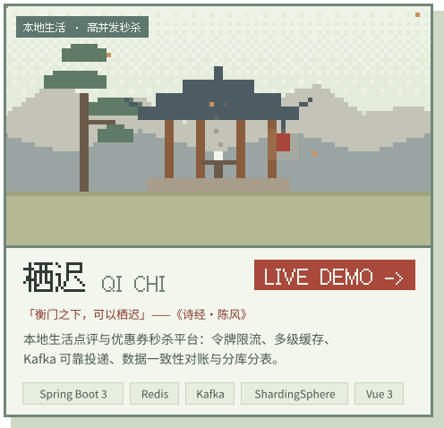
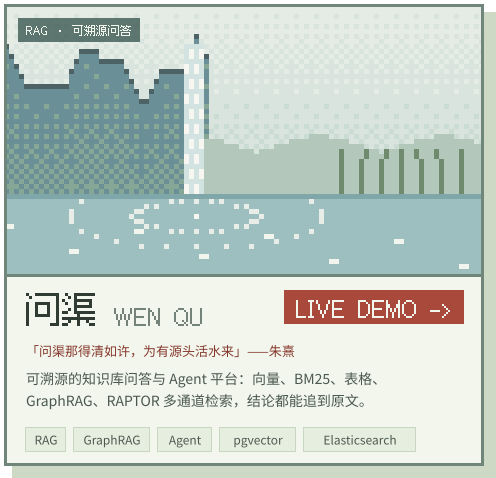

<!-- 平芜 · Joseph Z. Gray —— 横幅与卡片由 github-profile-tools/build.py 生成 -->

<a href="https://jzgaoblog.com">
  <picture>
    <source media="(prefers-color-scheme: dark)" srcset="./assets/banner-dark.svg">
    
  </picture>
</a>

  
  
  

### Hi there 👋

I'm **Joseph** (jzgao), a backend developer who likes getting things running in production — and then polishing them.

- 🧱 **Backend** — Java / Spring Boot, MySQL, Redis, Kafka, ShardingSphere
- 🔎 **RAG & Agents** — retrieval that cites its sources: vector · BM25 · tables · GraphRAG · RAPTOR
- 🚀 **Ship & polish** — deploying, load-testing and hardening my own services
- 🏔️ **Writing** — notes and side projects at [平芜 jzgaoblog.com](https://jzgaoblog.com)

### 🏗️ Featured projects

  <a href="https://qichi.jzgaoblog.com">
    <picture>
      <source media="(prefers-color-scheme: dark)" srcset="./assets/qichi-dark.svg">
      
    </picture>
  </a>
  <a href="https://wenqu.jzgaoblog.com/chat">
    <picture>
      <source media="(prefers-color-scheme: dark)" srcset="./assets/wenqu-dark.svg">
      
    </picture>
  </a>

### 🧰 Tech stack

  <picture>
    <source media="(prefers-color-scheme: dark)" srcset="https://skillicons.dev/icons?i=java%2Cspring%2Cmysql%2Credis%2Ckafka%2Cpostgres%2Celasticsearch%2Cpython%2Cvue%2Cdocker%2Cnginx%2Clinux%2Cgit%2Cmaven&perline=14&theme=dark">
    
  </picture>

<picture>
  <source media="(prefers-color-scheme: dark)" srcset="./assets/footer-dark.svg">
  
</picture>
