  

  

  
  
  
  

 

<table>
  <tr>
    <td width="44%" valign="top" align="left">
      <h3>👨‍💻 About Me</h3>
      <ul>
        <li>
          🧱 <b>后端开发</b>：Java / Spring Boot，高并发、缓存与消息队列 
          <i>Backend with Java &amp; Spring Boot — concurrency, caching, messaging.</i>
        </li>
        <li>
          🔎 <b>RAG 与 Agent</b>：多通道检索，每个结论都能追到原文 
          <i>Retrieval systems whose answers cite their sources.</i>
        </li>
        <li>
          🚀 <b>上线与打磨</b>：部署、压测、安全加固，再一点点优化 
          <i>Ship to production, load-test, harden — then polish.</i>
        </li>
        <li>
          ✍️ <b>写点东西</b>：<a href="https://jzgaoblog.com">平芜 jzgaoblog.com</a> 
          <i>Notes &amp; side projects.</i>
        </li>
      </ul>
    </td>
    <td width="56%" valign="middle" align="center">
      <picture>
        <source media="(prefers-color-scheme: dark)" srcset="./assets/terminal-dark.svg">
        
      </picture>
    </td>
  </tr>
</table>

### 🛠️ Tech Stack

  

### 🚀 Featured Projects

| Project | What it does | Stack | Demo |
|:---|:---|:---|:---:|
| **栖迟 QiChi** | 本地生活点评与优惠券秒杀平台：令牌限流、多级缓存、Kafka 可靠投递、数据一致性对账与分库分表 *Local-life reviews &amp; coupon flash-sale platform.* | Spring Boot 3 · Redis · Kafka · ShardingSphere · Vue 3 | [Live ↗](https://qichi.jzgaoblog.com) |
| **问渠 WenQu** | 可溯源的知识库问答与 Agent 平台：向量、BM25、表格、GraphRAG、RAPTOR 多通道检索，统一重排 *Traceable knowledge-base QA &amp; agent platform.* | RAG · GraphRAG · pgvector · Elasticsearch | [Live ↗](https://wenqu.jzgaoblog.com/chat) |

### 🐍 Contribution Activity

  <picture>
    <source media="(prefers-color-scheme: dark)" srcset="https://raw.githubusercontent.com/josephzgray/josephzgray/output/github-snake-dark.svg">
    
  </picture>

### 🤝 Contact &amp; Connect

  
  

 

  

